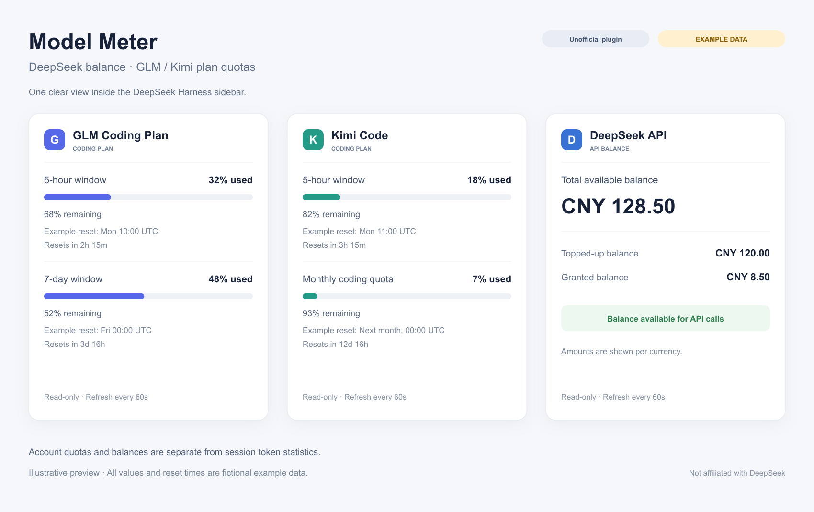

# Usage Panel · 用量面板

**非官方 DeepSeek Harness 社区插件。** 本项目由社区独立维护，不代表 DeepSeek、OpenAI、智谱或 Moonshot/Kimi 的官方产品、审核或推荐。

[English](README.en.md) · [DeepSeek Harness](https://github.com/deepseek-ai/deepseek-harness)

按当前选中的模型，在 Harness 右侧栏只显示对应服务商的 **ChatGPT/Coding Plan 套餐额度、重置时间或 DeepSeek 余额**。展示更简洁，切换模型时同步切换用量卡片。

## 支持什么

| 服务商 | 展示数据 |
|---|---|
| ChatGPT 订阅 | 服务商返回的套餐类型、积分及 5 小时、7 天等额度窗口和重置时间 |
| DeepSeek 登录账号 | 账号充值与赠送钱包余额，按币种分别显示 |
| DeepSeek API | 总可用余额、充值余额、赠送余额、API 余额是否可调用；CNY/USD 分别显示 |
| GLM Coding Plan | 服务商返回的 5 小时、7 天及其他套餐窗口，已用比例，重置时间与倒计时 |
| Kimi Code | 服务商返回的 5 小时、7 天、月度总量、月度编程等窗口，已用比例，重置时间与倒计时 |

- 每 60 秒自动刷新，支持手动刷新。
- 卡片顶栏使用服务商标志，减少重复文字；金额统一显示两位小数，宿主数据保留精度。
- 中英文界面随 Harness 语言设置切换。
- 只显示当前所选模型对应的服务商；未选择模型时显示选择提示，不支持的服务商显示明确状态。
- 套餐窗口只保留已用比例、进度条、重置时间与倒计时；不再重复展示剩余比例和原始计数。
- 不再展示会话 Token、上下文压力、轮次和耗时。额度/余额属于配置账号的整体用量，不是单个模型的独立消耗。
- 查询失败、缺少凭据、未提供的数据均有明确状态。

示例（演示数据）：



[离线交互演示](docs/demo.html)：下载后用浏览器打开，可切换 ChatGPT/GLM/Kimi/DeepSeek API/DeepSeek 账号示例、中英文和模拟刷新。预览图与演示均为界面示意，使用虚构数值，不是实际账号截图。

```text
选择 Kimi 模型 → 只显示 Kimi Code
5 小时窗口    已用 18%
重置时间      服务商返回的时间 · 距重置 2 小时 15 分
```

## 安装

在已初始化的 Harness profile 中安装。Desktop 用户先正常退出 Harness，再运行：

```sh
dsh plugin --profile desktop add github:Lirunhua/dsh-model-meter#v0.6.1
```

Web profile 使用：

```sh
dsh plugin --profile web add github:Lirunhua/dsh-model-meter#v0.6.1
```

macOS Desktop 没有配置 `dsh` 命令时，可用应用自带的 CLI：

```sh
"/Applications/DeepSeek Harness.app/Contents/Resources/runtime/cli/bin/dsh" \
  plugin --profile desktop add github:Lirunhua/dsh-model-meter#v0.6.1
```

也可下载发布页的预构建 `.tgz` 后本地安装：

```sh
dsh plugin --profile desktop add ./dsh-model-meter-0.6.1.tgz
```

重新打开 Harness，通过右侧栏 `+` 添加 **用量**（英文界面为 **Usage**），然后选择所用模型。技术包名和仓库地址继续使用 `dsh-model-meter`，以兼容已有安装与升级；公开名称为 **Usage Panel · 用量面板**。

本版本使用 Harness `0.2.1-rc.3` 的插件接口；`package.json` 声明最低版本，后续版本的兼容性以实际测试为准。插件已包含可运行的 `lib/`，安装时无需编译。

### 从旧的本地用量面板迁移

如果 profile 里已启用早期的 `dsh-usage-panel` 本地版本，先禁用或移除该组合包，再启用 Usage Panel，避免两个面板注册同一扩展点。本项目保留早期面板的内部标签标识，方便已有侧栏恢复。

## 配置账号

插件复用 Harness 模型设置中的凭据存储；同名环境变量由 Harness 原生凭据服务处理。

| 服务商 | 默认凭据引用 | 默认区域 |
|---|---|---|
| GLM Coding Plan | `ZAI_API_KEY` | Z.ai 国际站 |
| Kimi Code | `KIMI_CODING_API_KEY` | Kimi 国内站 |
| DeepSeek API | `DEEPSEEK_API_KEY` | DeepSeek 官方 API |

先在 Harness 的 Models/模型设置中配置对应账号。密钥留在宿主侧，不写入插件源码或浏览器页面。

ChatGPT 订阅需要先通过兼容的 [dsh-codex-subscription](https://github.com/WSL043/dsh-codex-subscription) 登录；插件读取 `codex-subscription/accounts` 中已激活的账号（version 1）。仅在该记录不存在时，才兼容旧的 `OPENAI_CODEX_SUBSCRIPTION_OAUTH` JSON 引用。不会自行选择其他已保存账号，也不刷新登录凭据。

DeepSeek 登录账号使用 Harness 内置账号登录，读取 `deepseek-account-platform/default` 授权记录。选择账号模型时查询账号钱包，选择 API Key 模型时查询 API 余额，两种来源独立。

需要改区域或凭据名称时，在所用 profile 的 `cordis.patch.yml` 中覆盖：

```yaml
- id: usage-panel
  name: dsh-model-meter
  config:
    glmRegion: zai                 # zai | bigmodel
    kimiRegion: cn                 # cn | international
    glmCredentialRef: ZAI_API_KEY
    kimiCredentialRef: KIMI_CODING_API_KEY
    deepseekCredentialRef: DEEPSEEK_API_KEY
    chatgptCredentialRef: OPENAI_CODEX_SUBSCRIPTION_OAUTH  # 仅旧格式回退
```

更改后重启 Harness。只向选定区域的官方地址查询，不自动跨站尝试同一个密钥。

## 数据含义与限制

- DeepSeek 登录账号展示钱包余额；API Key 模型展示 API 余额及其可用状态。账号钱包不推断 API 可调用状态，也不推算套餐百分比或重置时间。不同币种不相加，宿主金额保留十进制精度，界面按四舍五入显示两位小数。
- ChatGPT 展示当前已激活账号的服务商数据；主窗口和额外额度窗口分别保留。积分不是美元余额，不推算未返回的额度或重置时间。OpenAI API 按量付费余额不在支持范围内。
- ChatGPT 与 DeepSeek 登录账号属于兼容适配：依赖对应宿主凭据格式及服务商内部接口响应，并非稳定公开的额度 API 合约。接口或登录格式变化时可能需要更新；未在本版本发布验证中连接真实账号。
- Kimi Code 套餐与 Moonshot API 按量付费账号不同，不能混用。
- GLM/Kimi 的窗口是否存在、是否返回重置时间取决于服务商。缺失时显示“未提供”，不按零使用量处理。
- Kimi 同时返回新旧统计且同一窗口数值冲突时，优先采用有效原始计数。
- 当前模型只决定查询哪个服务商。查询使用本插件配置的服务商凭据；结果是该账号的套餐额度或余额，不是当前模型的专属额度。
- 这是用量查询插件，不提供充值、支付或账户修改操作。

### 数据来源

- [DeepSeek 余额接口](https://api-docs.deepseek.com/api/get-user-balance/)：`GET https://api.deepseek.com/user/balance`
- [GLM 官方查询实现](https://github.com/zai-org/zai-coding-plugins/blob/main/plugins/glm-plan-usage/skills/usage-query-skill/scripts/query-usage.mjs)：`GET /api/monitor/usage/quota/limit`，区域为 `api.z.ai` 或 `open.bigmodel.cn`
- [GLM 套餐说明](https://docs.bigmodel.cn/cn/coding-plan/overview)
- [Kimi 官方查询实现](https://github.com/MoonshotAI/kimi-code/blob/main/packages/oauth/src/managed-usage.ts)：`GET /coding/v1/usages`，区域为 `api.kimi.com` 或 `api.kimi.ai`
- [Kimi Server API 文档](https://www.kimi.com/code/docs/en/kimi-code-cli/reference/server-api.html)

账号兼容适配使用 `GET https://chatgpt.com/backend-api/wham/usage` 与 `GET https://platform.deepseek.com/api/v0/users/get_user_summary`。它们未被本项目当作公开稳定 API；ChatGPT 接入遵循 [OpenAI 凭据与会话说明](https://developers.openai.com/siwc/token-sharing-open-source/profiles-and-sessions)所述的宿主凭据边界。

## 隐私与请求

所有服务商查询都在 Harness 宿主进程执行，使用固定的官方只读接口、超时和缓存，并拒绝重定向。认证头、密钥和远端原始错误正文不会返回前端。本插件不发送模型推理请求，不向额外的统计服务上传账号信息。

## 开发与验证

需要 Node.js 22 或更高版本：

```sh
npm ci --ignore-scripts
npm test
npm pack --ignore-scripts
```

测试使用显式假凭据与模拟服务商响应，覆盖余额精度与两位小数显示、多币种、缺失字段、真实 Cordis 挂载/清理、切换账号的缓存隔离、授权来源、额外额度窗口、取消、超时、所选服务商过滤、界面显示与刷新生命周期。真实 Cordis 测试使用开发依赖，不因缺依赖而跳过。诊断其他运行时时可显式设置 `DSH_CORDIS_MODULE` 为可导入的 Cordis 模块地址。

问题与反馈：[GitHub Issues](https://github.com/Lirunhua/dsh-model-meter/issues)。报告问题时请删除密钥、认证头、个人余额和会话内容。

## License

[MIT](LICENSE)
